# 实验六：多模态内容安全检测系统设计与真实性评估

姓名：胡逸辰　学号：2024302181004

本报告由实际结果文件生成。报告中的二分类以伪造为正类；不把 AI 来源检测视为事实核查。实验范围与尚未完成项在文末列明。

## 1. 实验目标与系统结构

支持文字、图像、音频、视频四种输入。输入解码后分别提取基础特征和执行论文模型推理，用验证集进行正斜率逻辑概率校准，再比较基础方法、论文方法与等权平均方法。输出判定、置信度、证据、真实性评分及风险等级。

UI 展示预处理、特征线索、逐段／逐帧模型输出、运行参数与结果记录。跨模态采用等权融合，缺失模态重新归一化，同时保留最大分项风险和投票比例。课程数据不构成天然配对的四模态材料，因此不能声称已经证明跨模态融合的准确率。

## 2. 数据与防泄漏

课程分享包含 348 个样本：文本 100、图像 100、音频 50、视频 98。原始文件均保留，data/course_sources.json 保存来源、字节数与 SHA256，data/manifest.json 保存标签、组别和划分。划分固定随机种子 202430，按组约 60%/20%/20% 划为训练、验证、测试。

文本与视频同编号真假样本放在同组，扰动版本继承原样本划分。音频缺少说话人身份，无法保证说话人独立；视频身份独立性也未知。训练与验证结果不能混入最终测试。所有论文检测器的外部预训练数据与当前教学子集是否重合仍需审查。

```json
{
  "text": {
    "train": {
      "0": 30,
      "1": 30
    },
    "val": {
      "0": 10,
      "1": 10
    },
    "test": {
      "0": 10,
      "1": 10
    }
  },
  "image": {
    "train": {
      "0": 32,
      "1": 28
    },
    "val": {
      "0": 9,
      "1": 11
    },
    "test": {
      "0": 9,
      "1": 11
    }
  },
  "audio": {
    "train": {
      "0": 16,
      "1": 14
    },
    "val": {
      "0": 4,
      "1": 6
    },
    "test": {
      "0": 5,
      "1": 5
    }
  },
  "video": {
    "train": {
      "0": 29,
      "1": 29
    },
    "val": {
      "0": 10,
      "1": 10
    },
    "test": {
      "0": 10,
      "1": 10
    }
  }
}
```

## 3. 基础方法与论文方法

| 模态 | 基础方法 | 论文方法与实际适配 |
|---|---|---|
| 文本 | TF-IDF 单词1–2 gram + 逻辑回归，C=1 | Fast-DetectGPT 解析条件概率曲率；用 DistilGPT2 同时作为参考与评分模型，上限256 token。这是轻量适配，不是原论文的大模型配置，也未实现 OTBDetector |
| 图像 | 16维径向傅里叶统计、RGB均值方差、梯度统计 + 标准化逻辑回归，C=0.1 | UnivFD 官方 CLIP ViT-L/14 与官方线性头，短边224后中心裁剪，使用 CLIP 归一化 |
| 音频 | 16kHz、400点窗、160点移、24线性滤波器、20维LFCC均值/方差/差分绝对均值 + 标准化逻辑回归 | 官方 AASIST-L；64600点分段，短片段重复填充，官方类别0为spoof；全音频取片段概率均值 |
| 视频 | Haar最大人脸裁剪、8个均匀采样帧、图像基础特征的均值方差 + 标准化逻辑回归 | DeepfakeBench 发布的 FF++ Xception 检测权重，RGB 256×256，归一化[-1,1]，帧概率均值 |

全部深度权重严格加载，未使用随机初始化网络冒充检测器。Xception 只去掉框架注册器，架构未修改。第三方代码与许可证在 vendor 目录，下载记录见 models/sources.json。

文本曲率公式：将真实下一个 token 的对数概率与参考分布下的期望相减后求和，再除以方差之和的平方根。分数越高越倾向生成文本；截断部分在结果中标明。

校准只使用验证集，形式为 sigmoid(a×score+b)，约束 a>0，避免通过翻转论文模型方向掩盖跨域失败。基础与论文分数各自校准后等权平均，不根据测试集挑选融合权重。

UI 的存疑规则为置信度低于0.65，或两方法伪造概率相差超过0.5。测试指标统一使用0.5阈值的二分类结果，存疑不是第五种真值类别。小验证集的概率可靠性有限。

## 4. 留出测试结果

| 模态 | 方法 | 请求/有效 | 覆盖率 | 有效Accuracy | 失败计错Accuracy | 95% CI | Precision | Recall | F1 | 误报率 | 漏报率 | ROC-AUC | Brier |
|---|---|---:|---:|---:|---:|---|---:|---:|---:|---:|---:|---:|---:|
| 音频 | baseline | 10/10 | 1.000 | 0.9000 | 0.9000 | [0.700, 1.000] | 1.0000 | 0.8000 | 0.8889 | 0.0000 | 0.2000 | 1.0000 | 0.1071 |
| 音频 | combined | 10/10 | 1.000 | 0.9000 | 0.9000 | [0.700, 1.000] | 1.0000 | 0.8000 | 0.8889 | 0.0000 | 0.2000 | 1.0000 | 0.1202 |
| 音频 | paper | 10/10 | 1.000 | 0.5000 | 0.5000 | [0.200, 0.800] | 0.5000 | 1.0000 | 0.6667 | 1.0000 | 0.0000 | 0.4800 | 0.2600 |
| 图像 | baseline | 20/20 | 1.000 | 0.7000 | 0.7000 | [0.500, 0.900] | 0.6667 | 0.9091 | 0.7692 | 0.5556 | 0.0909 | 0.8586 | 0.1858 |
| 图像 | combined | 20/20 | 1.000 | 0.9000 | 0.9000 | [0.800, 1.000] | 0.8462 | 1.0000 | 0.9167 | 0.2222 | 0.0000 | 1.0000 | 0.1050 |
| 图像 | paper | 20/20 | 1.000 | 0.9500 | 0.9500 | [0.850, 1.000] | 0.9167 | 1.0000 | 0.9565 | 0.1111 | 0.0000 | 1.0000 | 0.0654 |
| 文本 | baseline | 20/20 | 1.000 | 1.0000 | 1.0000 | [1.000, 1.000] | 1.0000 | 1.0000 | 1.0000 | 0.0000 | 0.0000 | 1.0000 | 0.0238 |
| 文本 | combined | 20/20 | 1.000 | 1.0000 | 1.0000 | [1.000, 1.000] | 1.0000 | 1.0000 | 1.0000 | 0.0000 | 0.0000 | 1.0000 | 0.0094 |
| 文本 | paper | 20/20 | 1.000 | 1.0000 | 1.0000 | [1.000, 1.000] | 1.0000 | 1.0000 | 1.0000 | 0.0000 | 0.0000 | 1.0000 | 0.0107 |
| 视频 | baseline | 20/19 | 0.950 | 0.6842 | 0.6500 | [0.513, 0.850] | 0.6364 | 0.7778 | 0.7000 | 0.4000 | 0.2222 | 0.6444 | 0.2487 |
| 视频 | combined | 20/19 | 0.950 | 0.8947 | 0.8500 | [0.743, 1.000] | 0.8182 | 1.0000 | 0.9000 | 0.2000 | 0.0000 | 0.9111 | 0.1253 |
| 视频 | paper | 20/19 | 0.950 | 0.8947 | 0.8500 | [0.743, 1.000] | 0.8182 | 1.0000 | 0.9000 | 0.2000 | 0.0000 | 0.9444 | 0.0820 |

上表同时给出请求数/有效数、覆盖率、成功样本准确率、将处理失败计为错误的有效准确率，以及按原始样本组bootstrap得到的95%区间。未检出人脸等失败不自动归为真实。由于每模态课程留出集仅10–20例，区间很宽；可靠性图也必须结合每个分箱的样本数阅读，不能由一次100%结果推出普适能力。

## 5. 误报漏报分析

### 音频 / baseline

- audio_fake_fake_0023：漏报，伪造概率 0.0401

### 音频 / combined

- audio_fake_fake_0023：漏报，伪造概率 0.3201

### 音频 / paper

- audio_real_real_0000：误报，伪造概率 0.6001
- audio_real_real_0006：误报，伪造概率 0.6001
- audio_real_real_0019：误报，伪造概率 0.6001
- audio_real_real_0021：误报，伪造概率 0.6000
- audio_real_real_0024：误报，伪造概率 0.6000

### 图像 / baseline

- image_real_n01440764_10342：误报，伪造概率 0.5978
- image_real_n01644900_13175：误报，伪造概率 0.7220
- image_real_n02488291_1955：误报，伪造概率 0.7108
- image_real_n02504458_12945：误报，伪造概率 0.6110
- image_real_n02817516_5607：误报，伪造概率 0.5542
- image_fake_VQDM_1000_200_09_959_vqdm_00057：漏报，伪造概率 0.3249

### 图像 / combined

- image_real_n01440764_10342：误报，伪造概率 0.5414
- image_real_n01644900_13175：误报，伪造概率 0.5744

### 图像 / paper

- image_real_n01978455_7675：误报，伪造概率 0.5255

### 文本 / baseline

本次留出集未观察到错误；仍受测试规模与分布限制。

### 文本 / combined

本次留出集未观察到错误；仍受测试规模与分布限制。

### 文本 / paper

本次留出集未观察到错误；仍受测试规模与分布限制。

### 视频 / baseline

- video_real_0025：误报，伪造概率 0.6656
- video_real_0026：误报，伪造概率 0.5907
- video_real_0036：误报，伪造概率 0.7026
- video_real_0043：误报，伪造概率 0.7740
- video_fake_0009_fake：漏报，伪造概率 0.2135
- video_fake_0043_fake：处理失败：采样帧中未检测到人脸，不能进行人脸伪造评估
- video_fake_0045_fake：漏报，伪造概率 0.4890

### 视频 / combined

- video_real_0026：误报，伪造概率 0.6569
- video_real_0036：误报，伪造概率 0.7885

### 视频 / paper

- video_real_0026：误报，伪造概率 0.7230
- video_real_0036：误报，伪造概率 0.8745
- video_fake_0043_fake：处理失败：采样帧中未检测到人脸，不能进行人脸伪造评估

AASIST 的原始跨域表现须与校准后结果同时阅读。若模型分数不能区分两类，校准只能调整概率，不能创造辨别能力。图像真假原文件分别主要为JPEG/PNG，基础频域方法可能学习压缩线索，需结合JPEG重压缩结果分析。文本的词汇与风格差异也可能成为数据集捷径，必须用新领域和新生成器继续验证。

## 6. 普通扰动鲁棒性

文本测试空格、标点、错字与截断；图像测试JPEG90/50、缩放、模糊、噪声与亮度；音频测试30/20/10dB噪声、音量、8kHz往返重采样、截断与变速；视频当前测试提取后人脸裁剪的压缩、缩放、模糊和亮度，不能替代完整视频重编码测试。截断可能移除伪造线索，解释时需区分输入变化与检测器脆弱性。

### robustness_audio_baseline_summary

| 条件 | 强度 | 样本数 | Accuracy | FPR | FNR |
|---|---:|---:|---:|---:|---:|
| clean | 0 | 10 | 0.9000 | 0.0000 | 0.2000 |
| noise | 30 | 10 | 0.5000 | 0.0000 | 1.0000 |
| noise | 20 | 10 | 0.5000 | 0.0000 | 1.0000 |
| noise | 10 | 10 | 0.5000 | 0.0000 | 1.0000 |
| gain | 0.5 | 10 | 0.9000 | 0.0000 | 0.2000 |
| resample | 8000 | 10 | 0.8000 | 0.0000 | 0.4000 |
| truncate | 0.75 | 10 | 0.9000 | 0.0000 | 0.2000 |
| speed | 1.05 | 10 | 0.8000 | 0.0000 | 0.4000 |

### robustness_audio_paper_summary

| 条件 | 强度 | 样本数 | Accuracy | FPR | FNR |
|---|---:|---:|---:|---:|---:|
| clean | 0 | 10 | 0.5000 | 1.0000 | 0.0000 |
| noise | 30 | 10 | 0.5000 | 1.0000 | 0.0000 |
| noise | 20 | 10 | 0.5000 | 1.0000 | 0.0000 |
| noise | 10 | 10 | 0.5000 | 1.0000 | 0.0000 |
| gain | 0.5 | 10 | 0.5000 | 1.0000 | 0.0000 |
| resample | 8000 | 10 | 0.5000 | 1.0000 | 0.0000 |
| truncate | 0.75 | 10 | 0.5000 | 1.0000 | 0.0000 |
| speed | 1.05 | 10 | 0.5000 | 1.0000 | 0.0000 |

### robustness_image_baseline_summary

| 条件 | 强度 | 样本数 | Accuracy | FPR | FNR |
|---|---:|---:|---:|---:|---:|
| clean | 0 | 20 | 0.7000 | 0.5556 | 0.0909 |
| jpeg | 90 | 20 | 0.7000 | 0.5556 | 0.0909 |
| jpeg | 50 | 20 | 0.7000 | 0.5556 | 0.0909 |
| resize | 0.5 | 20 | 0.6500 | 0.6667 | 0.0909 |
| resize | 0.25 | 20 | 0.6500 | 0.7778 | 0.0000 |
| blur | 1 | 20 | 0.6500 | 0.6667 | 0.0909 |
| blur | 2 | 20 | 0.7000 | 0.6667 | 0.0000 |
| noise | 0.01 | 20 | 0.7000 | 0.5556 | 0.0909 |
| brightness | 0.7 | 20 | 0.6000 | 0.8889 | 0.0000 |

### robustness_image_paper_summary

| 条件 | 强度 | 样本数 | Accuracy | FPR | FNR |
|---|---:|---:|---:|---:|---:|
| clean | 0 | 20 | 0.9500 | 0.1111 | 0.0000 |
| jpeg | 90 | 20 | 0.8500 | 0.0000 | 0.2727 |
| jpeg | 50 | 20 | 0.9000 | 0.2222 | 0.0000 |
| resize | 0.5 | 20 | 0.9000 | 0.2222 | 0.0000 |
| resize | 0.25 | 20 | 0.8500 | 0.3333 | 0.0000 |
| blur | 1 | 20 | 0.9000 | 0.2222 | 0.0000 |
| blur | 2 | 20 | 0.8500 | 0.2222 | 0.0909 |
| noise | 0.01 | 20 | 0.9000 | 0.2222 | 0.0000 |
| brightness | 0.7 | 20 | 0.9500 | 0.1111 | 0.0000 |

### robustness_text_baseline_summary

| 条件 | 强度 | 样本数 | Accuracy | FPR | FNR |
|---|---:|---:|---:|---:|---:|
| clean | 0 | 20 | 1.0000 | 0.0000 | 0.0000 |
| spaces | 1 | 20 | 1.0000 | 0.0000 | 0.0000 |
| typos | 0.01 | 20 | 1.0000 | 0.0000 | 0.0000 |
| truncate | 0.75 | 20 | 1.0000 | 0.0000 | 0.0000 |
| truncate | 0.5 | 20 | 1.0000 | 0.0000 | 0.0000 |
| punctuation | 1 | 20 | 1.0000 | 0.0000 | 0.0000 |

### robustness_text_paper_summary

| 条件 | 强度 | 样本数 | Accuracy | FPR | FNR |
|---|---:|---:|---:|---:|---:|
| clean | 0 | 20 | 1.0000 | 0.0000 | 0.0000 |
| spaces | 1 | 20 | 0.8000 | 0.3000 | 0.1000 |
| typos | 0.01 | 20 | 0.5000 | 0.0000 | 1.0000 |
| truncate | 0.75 | 20 | 1.0000 | 0.0000 | 0.0000 |
| truncate | 0.5 | 20 | 0.9500 | 0.0000 | 0.1000 |
| punctuation | 1 | 20 | 0.9500 | 0.0000 | 0.1000 |

### robustness_video_baseline_summary

| 条件 | 强度 | 样本数 | Accuracy | FPR | FNR |
|---|---:|---:|---:|---:|---:|
| clean | 0 | 19 | 0.6842 | 0.4000 | 0.2222 |
| jpeg | 50 | 19 | 0.6842 | 0.4000 | 0.2222 |
| resize | 0.5 | 19 | 0.5789 | 0.7000 | 0.1111 |
| blur | 1 | 19 | 0.5789 | 0.7000 | 0.1111 |
| brightness | 0.7 | 19 | 0.4737 | 0.9000 | 0.1111 |

### robustness_video_paper_summary

| 条件 | 强度 | 样本数 | Accuracy | FPR | FNR |
|---|---:|---:|---:|---:|---:|
| clean | 0 | 19 | 0.8947 | 0.2000 | 0.0000 |
| jpeg | 50 | 19 | 0.7895 | 0.0000 | 0.4444 |
| resize | 0.5 | 19 | 0.8421 | 0.3000 | 0.0000 |
| blur | 1 | 19 | 0.8947 | 0.1000 | 0.1111 |
| brightness | 0.7 | 19 | 0.8421 | 0.3000 | 0.0000 |

## 7. 对抗自评与防御

攻击使用真实标签最大化二分类损失。FGSM单步、无随机初始化；PGD随机初始化，每步投影到L∞球并裁剪到合法值域。局部配置测试两个扰动强度与FGSM/PGD5，完整配置增加四个强度及PGD20三次重启。图像预算以[0,1]像素计，音频以[-1,1]波形幅值计。参数与实际L∞、L2、SNR均逐样本保存。

攻击成功率ASR = 原本正确且攻击后错误数 / 原本正确受攻击数。分母为0时记录null，不能填0；同时报告攻击后准确率，区分真实→伪造和伪造→真实。

平滑防御为3点／3×3均值滤波；防御实验重新穿过防御生成攻击，不能把旧攻击迁移结果当作白盒防御结果。防御保留原始干净验证集校准参数，未做防御特定校准。音频基础方法攻击完整波形，论文音频攻击第一个4.04秒模型片段，视频作用于第一个检测到的人脸裁剪；必须按各自威胁模型解释。音频基础方法另通过PCM16保存、重新读取检查攻击是否保留，量化误差另行计入，不能继续声称量化后严格满足原浮点预算。

### attacks_audio_baseline_full_summary

旧版摘要未记录原始请求数。

- 输入失败：无。

| 攻击 | ε | 防御 | 测试数 | 原本正确数 | ASR | 攻击后准确率 |
|---|---:|---|---:|---:|---:|---:|
| FGSM | 0.000500 | False | 10 | 9 | 0.4444444444444444 | 0.5 |
| PGD5 | 0.000500 | False | 10 | 9 | 1.0 | 0.0 |
| PGD20_R3 | 0.000500 | False | 10 | 9 | 1.0 | 0.0 |
| FGSM | 0.001000 | False | 10 | 9 | 0.4444444444444444 | 0.5 |
| PGD5 | 0.001000 | False | 10 | 9 | 1.0 | 0.0 |
| PGD20_R3 | 0.001000 | False | 10 | 9 | 1.0 | 0.0 |
| FGSM | 0.002000 | False | 10 | 9 | 0.4444444444444444 | 0.5 |
| PGD5 | 0.002000 | False | 10 | 9 | 1.0 | 0.0 |
| PGD20_R3 | 0.002000 | False | 10 | 9 | 1.0 | 0.0 |
| FGSM | 0.004000 | False | 10 | 9 | 0.4444444444444444 | 0.5 |
| PGD5 | 0.004000 | False | 10 | 9 | 1.0 | 0.0 |
| PGD20_R3 | 0.004000 | False | 10 | 9 | 1.0 | 0.0 |
| FGSM | 0.000500 | True | 10 | 9 | 0.5555555555555556 | 0.4 |
| PGD5 | 0.000500 | True | 10 | 9 | 1.0 | 0.0 |
| PGD20_R3 | 0.000500 | True | 10 | 9 | 1.0 | 0.0 |
| FGSM | 0.001000 | True | 10 | 9 | 0.4444444444444444 | 0.5 |
| PGD5 | 0.001000 | True | 10 | 9 | 1.0 | 0.0 |
| PGD20_R3 | 0.001000 | True | 10 | 9 | 1.0 | 0.0 |
| FGSM | 0.002000 | True | 10 | 9 | 0.4444444444444444 | 0.5 |
| PGD5 | 0.002000 | True | 10 | 9 | 1.0 | 0.0 |
| PGD20_R3 | 0.002000 | True | 10 | 9 | 1.0 | 0.0 |
| FGSM | 0.004000 | True | 10 | 9 | 0.4444444444444444 | 0.5 |
| PGD5 | 0.004000 | True | 10 | 9 | 1.0 | 0.0 |
| PGD20_R3 | 0.004000 | True | 10 | 9 | 1.0 | 0.0 |

### attacks_audio_paper_local_summary

旧版摘要未记录原始请求数。

- 输入失败：无。

| 攻击 | ε | 防御 | 测试数 | 原本正确数 | ASR | 攻击后准确率 |
|---|---:|---|---:|---:|---:|---:|
| FGSM | 0.001000 | False | 10 | 5 | 0.0 | 0.5 |
| PGD5 | 0.001000 | False | 10 | 5 | 0.0 | 0.5 |
| FGSM | 0.004000 | False | 10 | 5 | 0.0 | 0.5 |
| PGD5 | 0.004000 | False | 10 | 5 | 0.0 | 0.5 |
| FGSM | 0.001000 | True | 10 | 5 | 0.0 | 0.5 |
| PGD5 | 0.001000 | True | 10 | 5 | 0.0 | 0.5 |
| FGSM | 0.004000 | True | 10 | 5 | 0.0 | 0.5 |
| PGD5 | 0.004000 | True | 10 | 5 | 0.0 | 0.5 |

### attacks_image_paper_full_summary

请求 20 个原始样本，有效 20，输入覆盖率 100.00%，失败 0。

- 输入失败：无。

| 攻击 | ε | 防御 | 测试数 | 原本正确数 | ASR | 攻击后准确率 |
|---|---:|---|---:|---:|---:|---:|
| FGSM | 0.003922 | False | 20 | 19 | 0.8947368421052632 | 0.1 |
| PGD5 | 0.003922 | False | 20 | 19 | 1.0 | 0.0 |
| PGD20_R3 | 0.003922 | False | 20 | 19 | 1.0 | 0.0 |
| FGSM | 0.007843 | False | 20 | 19 | 0.9473684210526315 | 0.05 |
| PGD5 | 0.007843 | False | 20 | 19 | 1.0 | 0.0 |
| PGD20_R3 | 0.007843 | False | 20 | 19 | 1.0 | 0.0 |
| FGSM | 0.015686 | False | 20 | 19 | 0.8421052631578947 | 0.15 |
| PGD5 | 0.015686 | False | 20 | 19 | 1.0 | 0.0 |
| PGD20_R3 | 0.015686 | False | 20 | 19 | 1.0 | 0.0 |
| FGSM | 0.031373 | False | 20 | 19 | 0.8421052631578947 | 0.15 |
| PGD5 | 0.031373 | False | 20 | 19 | 1.0 | 0.0 |
| PGD20_R3 | 0.031373 | False | 20 | 19 | 1.0 | 0.0 |
| FGSM | 0.003922 | True | 20 | 19 | 1.0 | 0.0 |
| PGD5 | 0.003922 | True | 20 | 19 | 1.0 | 0.0 |
| PGD20_R3 | 0.003922 | True | 20 | 19 | 1.0 | 0.0 |
| FGSM | 0.007843 | True | 20 | 19 | 1.0 | 0.0 |
| PGD5 | 0.007843 | True | 20 | 19 | 1.0 | 0.0 |
| PGD20_R3 | 0.007843 | True | 20 | 19 | 1.0 | 0.0 |
| FGSM | 0.015686 | True | 20 | 19 | 0.7894736842105263 | 0.2 |
| PGD5 | 0.015686 | True | 20 | 19 | 1.0 | 0.0 |
| PGD20_R3 | 0.015686 | True | 20 | 19 | 1.0 | 0.0 |
| FGSM | 0.031373 | True | 20 | 19 | 0.631578947368421 | 0.35 |
| PGD5 | 0.031373 | True | 20 | 19 | 1.0 | 0.0 |
| PGD20_R3 | 0.031373 | True | 20 | 19 | 1.0 | 0.0 |

### attacks_image_paper_local_summary

旧版摘要未记录原始请求数。

- 输入失败：无。

| 攻击 | ε | 防御 | 测试数 | 原本正确数 | ASR | 攻击后准确率 |
|---|---:|---|---:|---:|---:|---:|
| FGSM | 0.007843 | False | 2 | 2 | 1.0 | 0.0 |
| PGD5 | 0.007843 | False | 2 | 2 | 1.0 | 0.0 |
| FGSM | 0.031373 | False | 2 | 2 | 1.0 | 0.0 |
| PGD5 | 0.031373 | False | 2 | 2 | 1.0 | 0.0 |
| FGSM | 0.007843 | True | 2 | 2 | 1.0 | 0.0 |
| PGD5 | 0.007843 | True | 2 | 2 | 1.0 | 0.0 |
| FGSM | 0.031373 | True | 2 | 2 | 1.0 | 0.0 |
| PGD5 | 0.031373 | True | 2 | 2 | 1.0 | 0.0 |

### attacks_video_paper_full_summary

请求 20 个原始样本，有效 19，输入覆盖率 95.00%，失败 1。

- 输入失败：video_fake_0043_fake；阶段=decode_or_face_detection；原因=采样帧中未检测到人脸，不能进行人脸伪造评估

| 攻击 | ε | 防御 | 测试数 | 原本正确数 | ASR | 攻击后准确率 |
|---|---:|---|---:|---:|---:|---:|
| FGSM | 0.003922 | False | 19 | 14 | 1.0 | 0.0 |
| PGD5 | 0.003922 | False | 19 | 14 | 1.0 | 0.0 |
| PGD20_R3 | 0.003922 | False | 19 | 14 | 1.0 | 0.0 |
| FGSM | 0.007843 | False | 19 | 14 | 1.0 | 0.0 |
| PGD5 | 0.007843 | False | 19 | 14 | 1.0 | 0.0 |
| PGD20_R3 | 0.007843 | False | 19 | 14 | 1.0 | 0.0 |
| FGSM | 0.015686 | False | 19 | 14 | 0.9285714285714286 | 0.10526315789473684 |
| PGD5 | 0.015686 | False | 19 | 14 | 1.0 | 0.0 |
| PGD20_R3 | 0.015686 | False | 19 | 14 | 1.0 | 0.0 |
| FGSM | 0.031373 | False | 19 | 14 | 0.42857142857142855 | 0.5263157894736842 |
| PGD5 | 0.031373 | False | 19 | 14 | 1.0 | 0.0 |
| PGD20_R3 | 0.031373 | False | 19 | 14 | 1.0 | 0.0 |
| FGSM | 0.003922 | True | 19 | 15 | 1.0 | 0.0 |
| PGD5 | 0.003922 | True | 19 | 15 | 1.0 | 0.0 |
| PGD20_R3 | 0.003922 | True | 19 | 15 | 1.0 | 0.0 |
| FGSM | 0.007843 | True | 19 | 15 | 1.0 | 0.0 |
| PGD5 | 0.007843 | True | 19 | 15 | 1.0 | 0.0 |
| PGD20_R3 | 0.007843 | True | 19 | 15 | 1.0 | 0.0 |
| FGSM | 0.015686 | True | 19 | 15 | 0.9333333333333333 | 0.05263157894736842 |
| PGD5 | 0.015686 | True | 19 | 15 | 1.0 | 0.0 |
| PGD20_R3 | 0.015686 | True | 19 | 15 | 1.0 | 0.0 |
| FGSM | 0.031373 | True | 19 | 15 | 0.4666666666666667 | 0.5263157894736842 |
| PGD5 | 0.031373 | True | 19 | 15 | 1.0 | 0.0 |
| PGD20_R3 | 0.031373 | True | 19 | 15 | 1.0 | 0.0 |

### attacks_video_paper_local_summary

旧版摘要未记录原始请求数。

- 输入失败：无。

| 攻击 | ε | 防御 | 测试数 | 原本正确数 | ASR | 攻击后准确率 |
|---|---:|---|---:|---:|---:|---:|
| FGSM | 0.007843 | False | 2 | 2 | 1.0 | 0.0 |
| PGD5 | 0.007843 | False | 2 | 2 | 1.0 | 0.0 |
| FGSM | 0.031373 | False | 2 | 2 | 0.5 | 0.5 |
| PGD5 | 0.031373 | False | 2 | 2 | 1.0 | 0.0 |
| FGSM | 0.007843 | True | 2 | 2 | 1.0 | 0.0 |
| PGD5 | 0.007843 | True | 2 | 2 | 1.0 | 0.0 |
| FGSM | 0.031373 | True | 2 | 2 | 0.5 | 0.5 |
| PGD5 | 0.031373 | True | 2 | 2 | 1.0 | 0.0 |

## 8. 可复现性与运行

课程指标与原本地结果来自Windows CPU环境；新增CIFAKE评估和图像/视频full白盒攻击在RTX 4090 D上运行。results/gpu_preflight.json记录torch/CUDA版本、实际设备、显存峰值、CPU/GPU分数差与输入梯度检查。GPU攻击在独立工作区生成后以独立文件名和证据目录合并，未覆盖原CPU快照。LAB_DEVICE=cpu/cuda/auto控制设备，所有路径相对项目根目录。

运行顺序、安装和迁移命令见README.md。单元验证覆盖来源哈希、分组无交叉、扰动预算与攻击方向、校准不翻转模型、官方权重严格加载。

## 9. 当前局限与后续工作

- 已加入CIFAKE独立图像测试，但其32×32对象图像与Stable Diffusion 1.4单一生成器仍不能代表高分辨率、现代生成器或视频跨域泛化。
- 尚无独立外部视频语料；视频采用最大人脸与均匀抽帧，无身份跟踪，不保证短时局部篡改均被采样。
- 尚未收集用户本人拍摄／录制的真人材料，不能把公开下载数据写成个人实拍。
- 文本主要为英语，中文、新型生成器与人机混写需另建测试集。
- 音频基础特征受声学条件影响，AASIST存在跨数据集失效风险。
- 图像/视频白盒攻击作用于模型输入裁剪，不等于编码、解码、人脸检测全流程攻击。
- 尚未进行对抗训练；不能把平滑防御实验写成已获得认证鲁棒性。
- 风险分数与显著性线索均不能证明某人造假或内容事实错误。


## 10. 默认方法选择与论文失效分析

| 模态 | 最终默认方法 | 课程验证集基础平衡准确率 | 课程验证集论文平衡准确率 |
|---|---|---:|---:|
| 文本 | paper | 1.0 | 1.0 |
| 图像 | paper | 0.4949494949494949 | 0.797979797979798 |
| 音频 | baseline | 1.0 | 0.5 |
| 视频 | paper | 0.7 | 0.95 |

文本额外使用独立外部验证数据，按领域等权平均平衡准确率选择默认方法；其余模态使用课程验证集。同分优先基础方法。融合仅为消融对照，不强制作为默认。选择理由与全部候选指标保留在configs/selected_methods.json。

### 为什么某些论文方法会较差

音频：官方AASIST-L主要在ASVspoof2019 LA训练，当前SecureAudio的说话人、合成算法、声道与录制条件可能不同。已复核官方类别0=spoof、类别1=bonafide、16kHz、64600点重复填充，严格加载权重，未发现由标签反转或随机初始化造成的失败。当前实际结果支持“跨域辨别力不足”：原始ROC-AUC、真实与伪造分数重叠、校准斜率和误报率均应结合阅读。具体由哪种声学差异主导尚未通过控制实验确定，不能把可能原因写成已证明结论。

文本：TF-IDF基础方法能捕捉课程AI文本中的词汇与写作习惯，课程小样本得分很高，但外部GPT-2文本表现下降。条件概率曲率方法依赖语言模型的token概率，减少了对固定词汇的直接依赖，跨来源结果更好。DistilGPT2仍是本项目的轻量适配，不能以此推断它对中文、现代推理模型或所有改写都有效。

图像与视频：以实际验证结果决定默认方法，不预设深度论文方法必胜。UnivFD使用官方权重，但本地采用标准CLIP短边缩放再中心裁剪；官方仓库validate.py使用仅中心裁剪，因此本项目不是逐参数复现。该适配在本报告中明确列出，不能直接对照论文表格宣称复现其精度。视频使用Haar最大人脸代替原框架完整对齐流程，同样存在预处理域差异。

防御：均值平滑对某些高频扰动可能有作用，但本项目对攻击穿过防御重新优化后观察到防御失效。这说明不能只展示一张视觉变化很小的攻击图片，也不能把基础方法正常检测较好等同于对抗鲁棒。

### 补充数据与冻结评估

| 实验 | 方法 | 请求/有效 | 覆盖率 | 有效Accuracy | 失败计错Accuracy | 95% CI | FPR | FNR | ROC-AUC |
|---|---|---:|---:|---:|---:|---|---:|---:|---:|
| external_audio_baseline_summary | baseline | 358/358 | 1.000 | 0.8352 | 0.8352 | N/A | 0.0435 | 0.2931 | 0.9333 |
| external_audio_paper_summary | paper | 358/358 | 1.000 | 0.4860 | 0.4860 | N/A | 1.0000 | 0.0000 | 0.4212 |
| external_text_baseline_summary | baseline | 200/200 | 1.000 | 0.5250 | 0.5250 | N/A | 0.0200 | 0.9300 | 0.4148 |
| external_text_paper_summary | paper | 200/200 | 1.000 | 0.9300 | 0.9300 | N/A | 0.0000 | 0.1400 | 0.9751 |
| external_validation_text_baseline_summary | baseline | 200/200 | 1.000 | 0.4950 | 0.4950 | N/A | 0.0700 | 0.9400 | 0.4403 |
| external_validation_text_paper_summary | paper | 200/200 | 1.000 | 0.9150 | 0.9150 | N/A | 0.0000 | 0.1700 | 0.9826 |
| final_external_text_baseline_summary | baseline | 200/200 | 1.000 | 0.4850 | 0.4850 | N/A | 0.0800 | 0.9500 | 0.3715 |
| final_external_text_paper_summary | paper | 200/200 | 1.000 | 0.9450 | 0.9450 | N/A | 0.0200 | 0.0900 | 0.9887 |
| cifake_external_image_baseline_summary | baseline | 200/200 | 1.000 | 0.5000 | 0.5000 | [0.435, 0.575] | 1.0000 | 0.0000 | 0.3261 |
| cifake_external_image_combined_summary | combined | 200/200 | 1.000 | 0.5000 | 0.5000 | [0.435, 0.575] | 1.0000 | 0.0000 | 0.2948 |
| cifake_external_image_paper_summary | paper | 200/200 | 1.000 | 0.4800 | 0.4800 | [0.415, 0.555] | 0.9900 | 0.0500 | 0.3348 |
| cifake_external_image_selected_summary | selected | 200/200 | 1.000 | 0.4800 | 0.4800 | [0.415, 0.555] | 0.9900 | 0.0500 | 0.3348 |

最初200条外部文本为诊断集。观察到来源偏移后，另从官方valid划分采集200条验证数据，并从test划分后续未使用索引采集200条新的最终测试数据。模型训练和概率校准仍仅使用课程训练／验证划分；新最终测试不参与方法选择。补充音频仍是同语料扩展。CIFAKE外部图像子集固定取自官方test划分：100张CIFAR-10真实图与100张Stable Diffusion 1.4生成图；按源行号哈希预先选样，未查看模型输出，且与课程集无精确字节重复。32×32分辨率造成明显域偏移，因此它是压力测试而不是通用视觉性能证明。

### 证据图与交付清单

逐样本分数、异常、误报漏报、校准参数及攻击前后数组均保留。UI通过实际HTTP上传与队列接口测试四模态、联合评估、图表及结果下载；视觉检查工具初始化故障，因此接口通过不能替代页面布局截图验收。报告提供操作说明作为课件允许的演示材料。

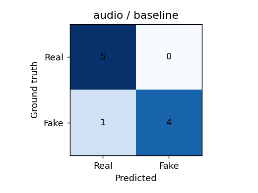


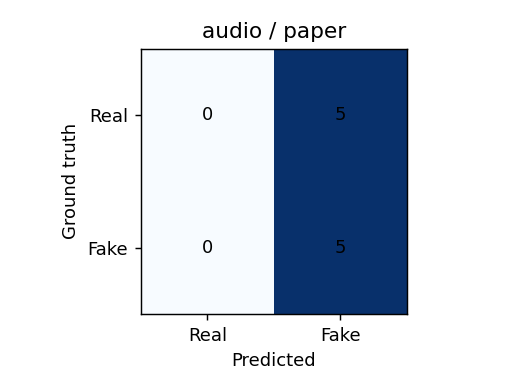

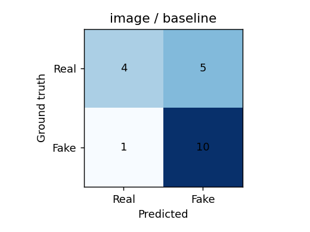

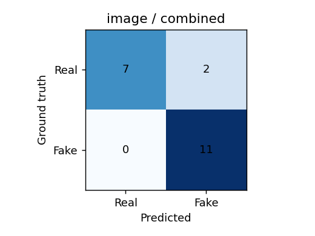

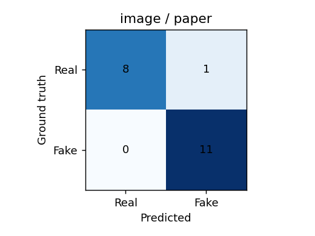

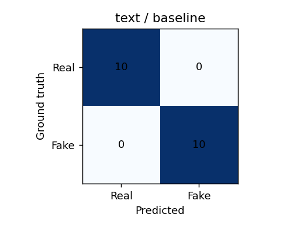


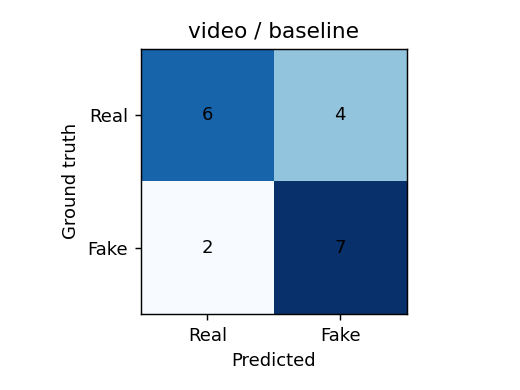


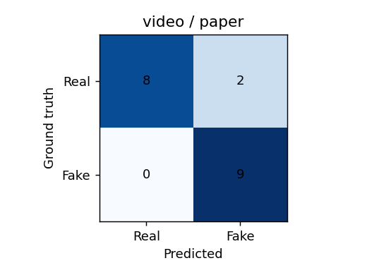

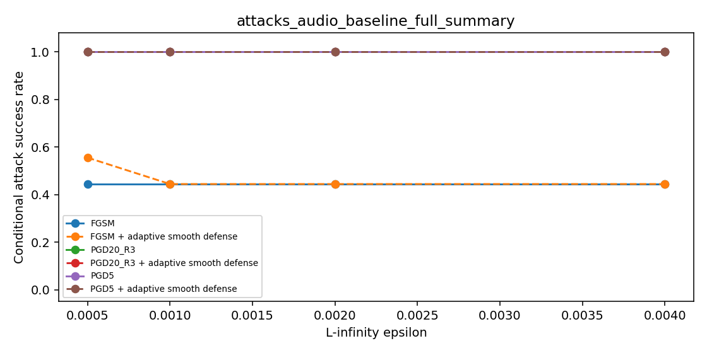

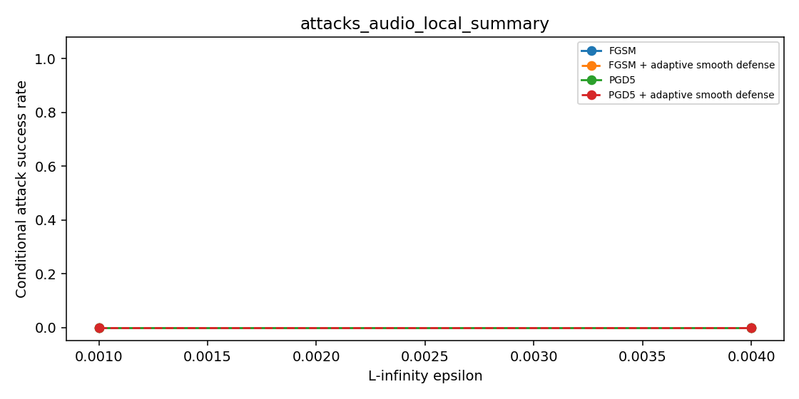

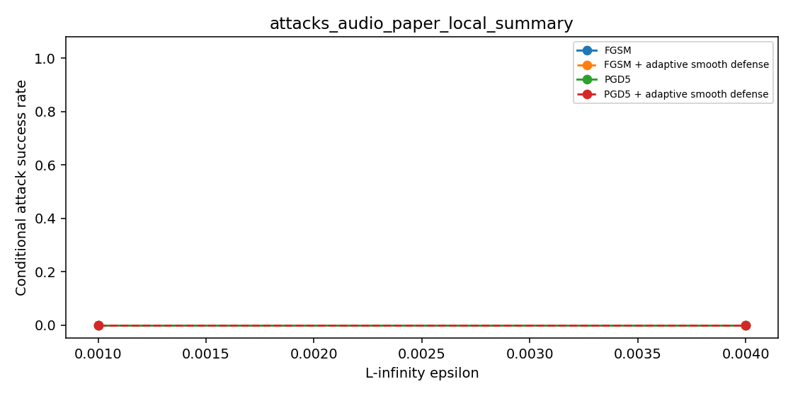

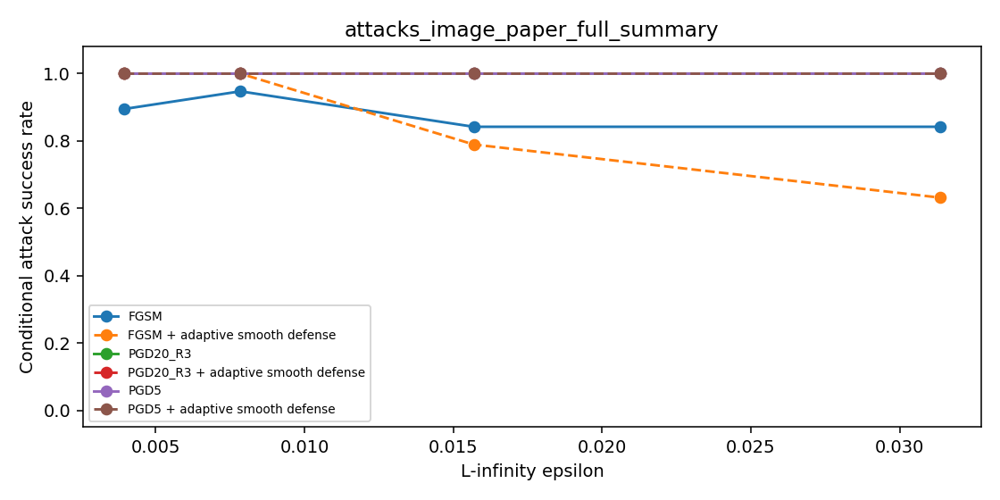

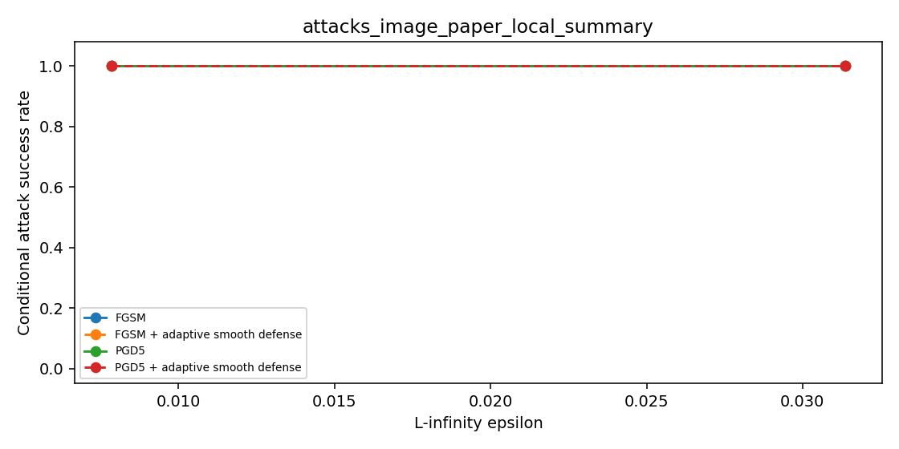

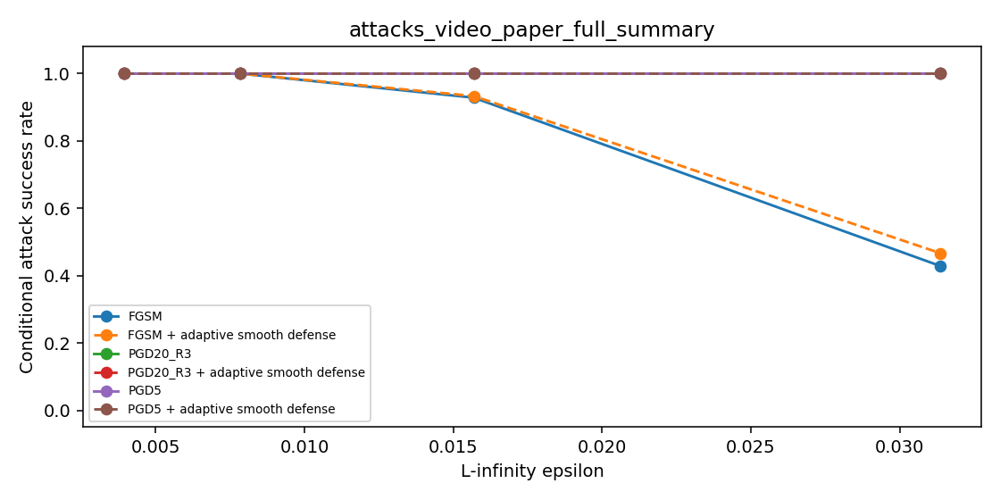

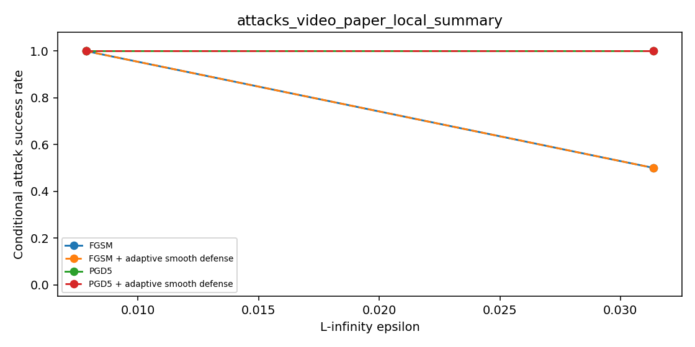

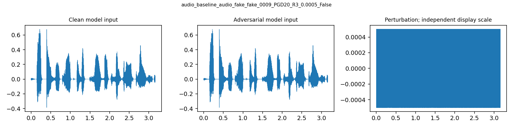

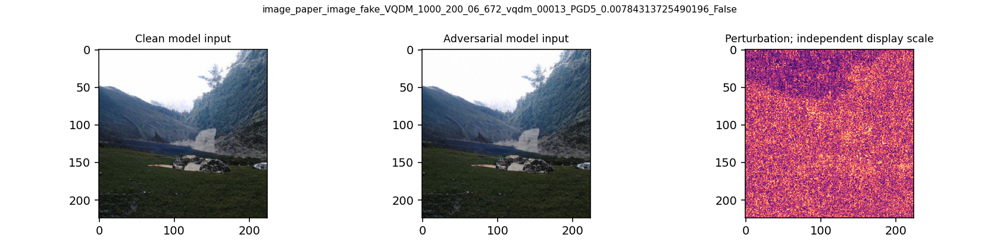

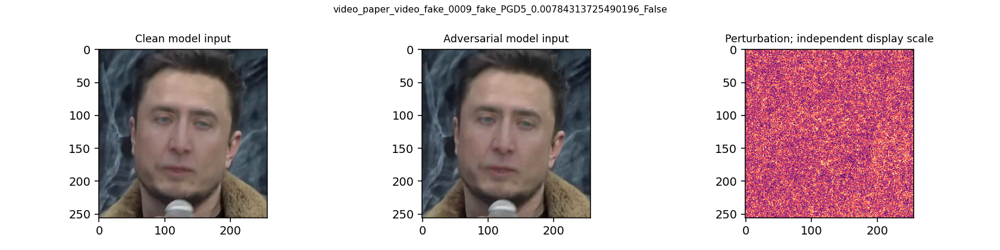

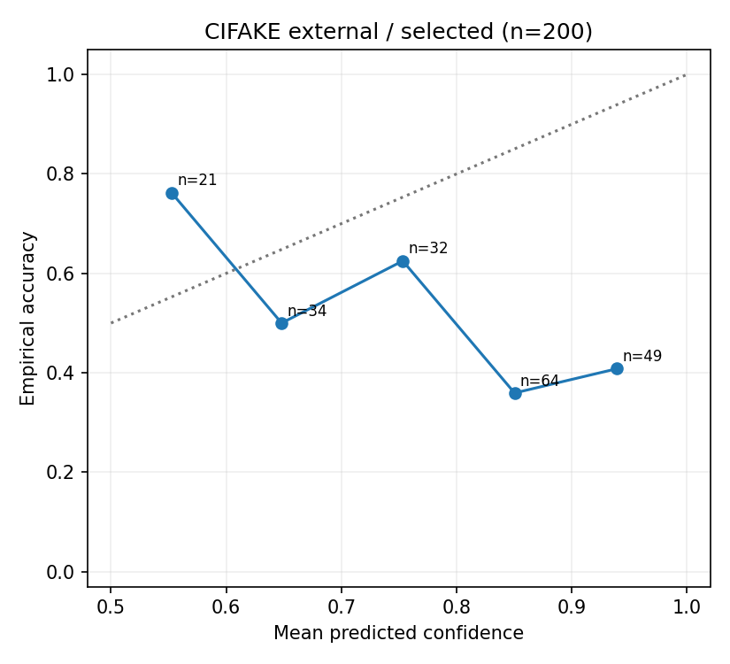

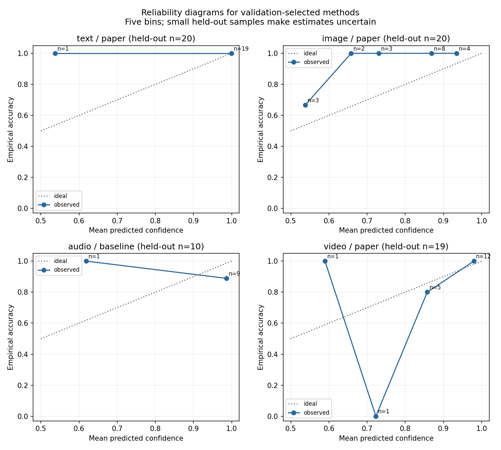

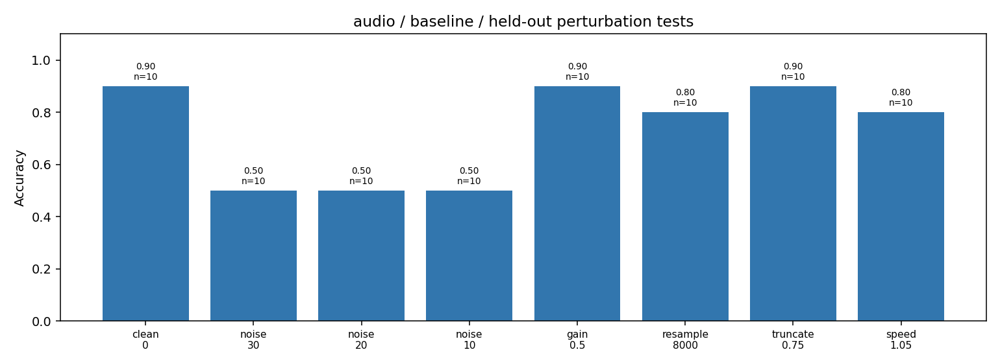

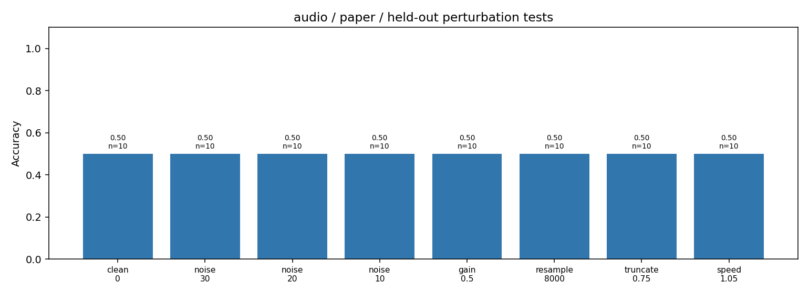

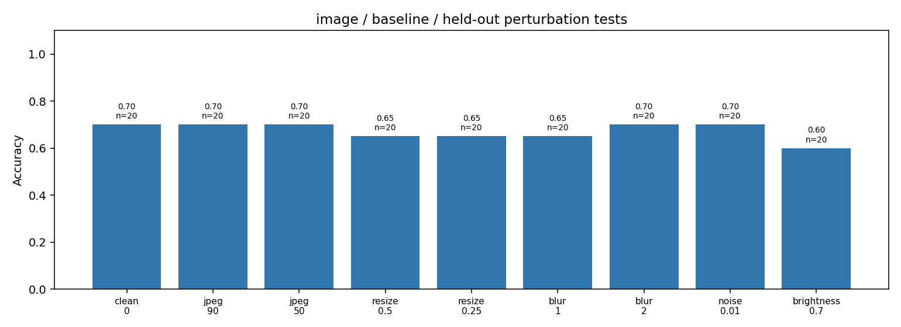

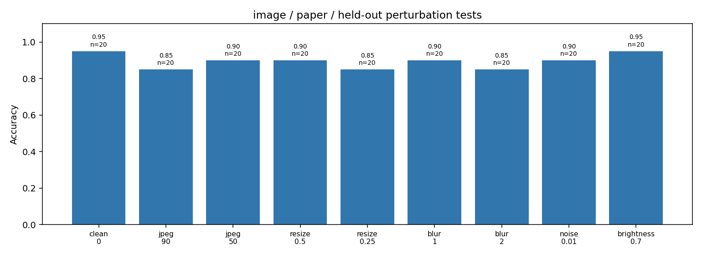

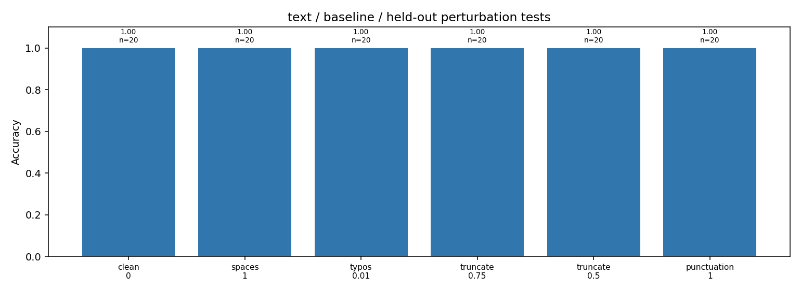

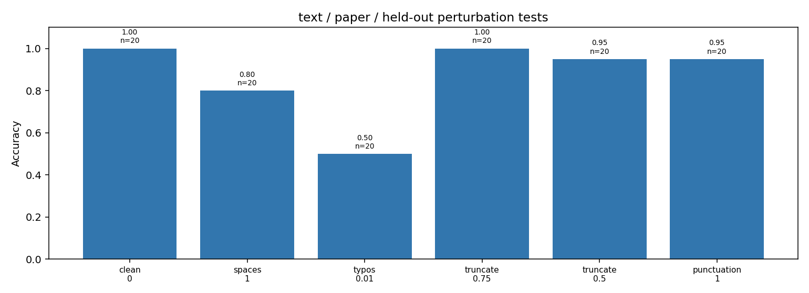

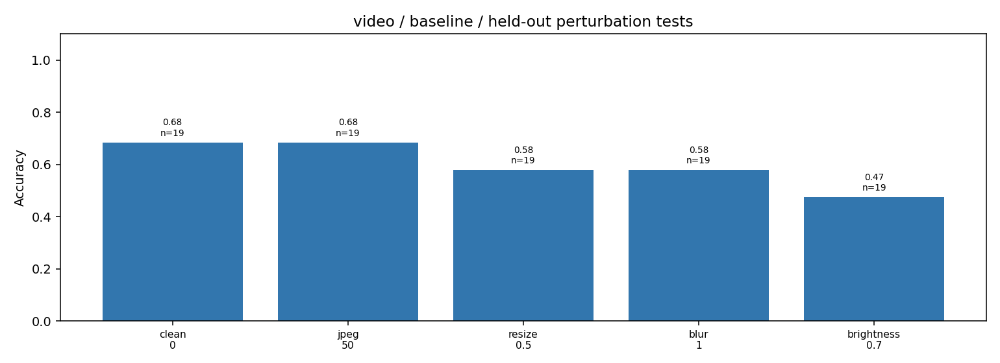

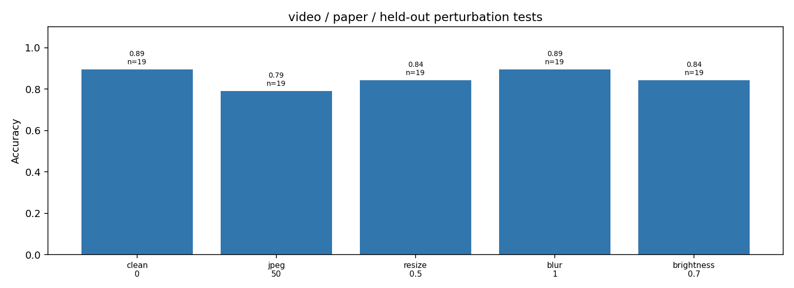

### 表面属性捷径对照

| 模态 | 仅用于审计的属性 | 留出准确率 |
|---|---|---:|
| 文本 | length, word count, vocabulary diversity, newlines | 0.8500 |
| 图像 | width, height, PNG/JPEG format | 1.0000 |
| 音频 | duration, sample rate, channels, RMS | 0.7000 |
| 视频 | width, height, FPS, duration | 0.5000 |

这些审计分类器未用于部署。图像格式即可高分提示数据构造存在捷径，不证明主模型直接读取了扩展名。主图像检测器只接收RGB像素，但仍可能受到历史压缩痕迹影响。

用户本人实拍／自录材料尚未提供；自主采集部分使用公开来源真实与生成测试语料，来源与哈希可追溯。补充文本来自GPT-2家族，与DistilGPT2参考模型存在模型家族亲缘，因此该测试不能代表对未知现代生成器的泛化。图像20例和视频19个有效样本的full多重启攻击已经完成；尚未完成的是独立外部视频集、完整媒体文件链路、更多高分辨率图像生成器和对抗训练。

## 11. 参考文献与来源

- [课程要求](references/实验6_多模态内容安全检测系统设计与真实性评估.pptx)
- [数据集说明](references/内容安全实验_数据集介绍 (1).pptx)
- [OpenTuringBench, EMNLP2025](https://aclanthology.org/2025.emnlp-main.1354/)
- [Fast-DetectGPT, ICLR2024](https://github.com/baoguangsheng/fast-detect-gpt)
- [UnivFD, CVPR2023](https://github.com/WisconsinAIVision/UniversalFakeDetect)
- [AASIST, ICASSP2022](https://github.com/clovaai/aasist)
- [FaceForensics++, ICCV2019](https://github.com/ondyari/FaceForensics)
- [CIFAKE, IEEE Access 2024](https://doi.org/10.1109/ACCESS.2024.3356122)
- [DeepfakeBench (Xception weights and architecture)](https://github.com/SCLBD/DeepfakeBench)

